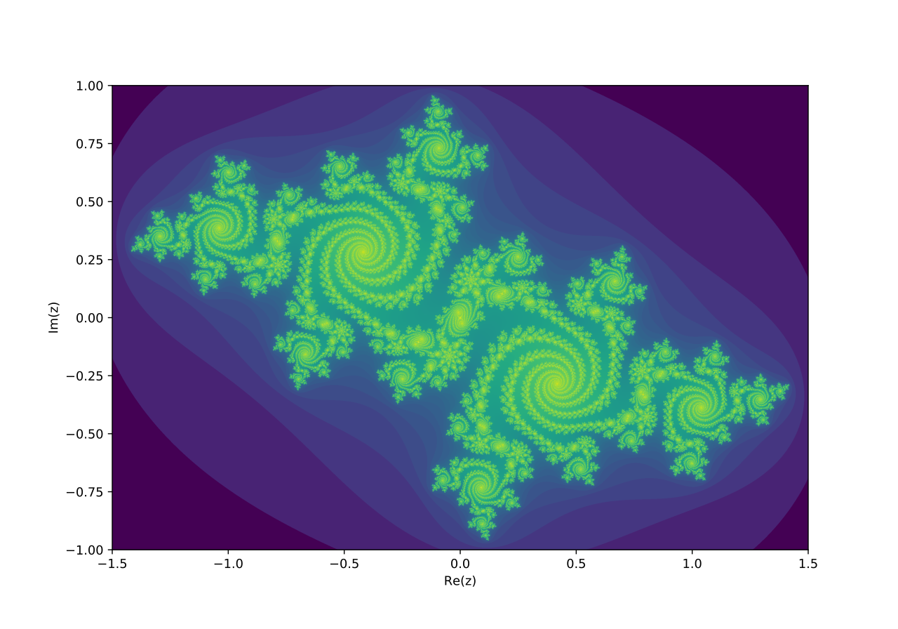
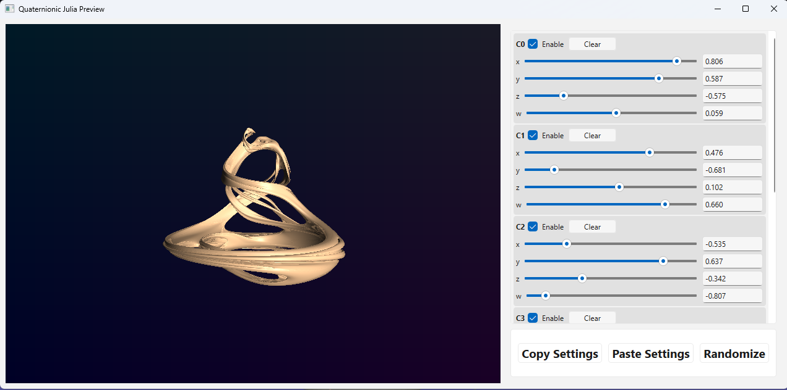
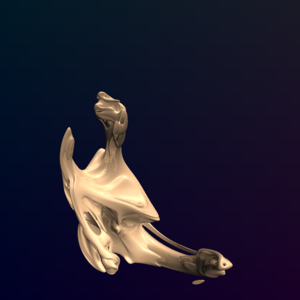
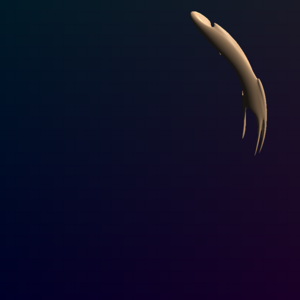

# Overview

JuliaSDF is a set of python tools for generating 3D-printable art based on quaternionic Julia sets. Here are a few examples of what this can look like:

| ex1 | ex2 | ex3 | ex4 |
| ex5 | ex6 | ex7 | ex8 |

The project has two main parts:
1. A PyQT-based GUI tool for visulalizing polynomial quaternionic Julia sets for fast searching using your graphics card.
2. An extension of the excellent [SDF](https://github.com/fogleman/sdf/blob/main/README.md) module to allow boolean operations and mesh export with the shapes defined by quaternionic julia sets. 

This project was inspired by the beautiful work of Inigo Quilez on computed renderings of quaternionic Julia sets. 

# Background

## Signed Distance Functions (SDFs)
SDFs are a flexible and powerful way to mathematically represent geometry that is well suited to the organic forms we're trying to generate. 

Given a solid object $U$, the SDF of $U$ is a scalar-valued function of space $u(\vec{r})$, defined as the distance bettween $\vec{r}$ and the surface of $U$ if $\vec{r}$ is outside $U$ and the negative of that distance if $\vec{r}$ is inside (hence Signed Distance Function). Given an SDF $v(\vec{r})$, the corresponding solid body can be recovered as the set of points where $v(\vec{r})\leq 0$. The useful thing about representing geometry in this way is that boolean operations between solid bodies can be expressed as mathematical combinations of their SDFs:

$$
W = U \cup V \longleftrightarrow w(\vec{r}) = \min(u(\vec{r}), v(\vec{r})) \\
W = U \cap V \longleftrightarrow w(\vec{r}) = \max(u(\vec{r}), v(\vec{r})) \\
W = U - V \longleftrightarrow w(\vec{r}) = \max(u(\vec{r}), -v(\vec{r}))
$$

Transformations of SDFs can be described by vector functions operating on their argument. For instance, to translate a the body represented by $u(\vec{r})$ by 2 in the $\hat{z}$ direction and stretch it by a factor of 1.5 in the $\hat{y}$ direction, we'd make the substitution

$$u(r_x,r_y,r_z) \longrightarrow u(r_x, r_y / 1.5, r_z - 2)$$

Note that the resultant transformed function is no longer strictly speaking an SDF of the body it represents: the $u=0$ contour will be in the right place, but points not on the surface may have incorrect distances because of the scaling. For most of the things we want to do with these functions the distinction is minor, but it's still worth keeping in mind. In particular our quaternionic Julia set SDFs will be very approximate and only approach the correct value for points very close to the surface being defined. 

Once we have an (approximate) SDF of a body, we can convert it into more translatable formats (STL, PLY, etc.) using a well-established algorithm called [Marching Cubes](https://en.wikipedia.org/wiki/Marching_cubes). As its name suggests, this works by subdividing the space to be meshed into cubic elements and evaluating the SDF at each vertex. If the sign of the SDF differs between the vertecies we know the surface must pass through the cube and based on the combination of positive and negative vertecies we can generate a mesh primitive (one or two triangles) to approximate it. In the usual algorithm the mesh vertecies are defined by linearly interpolating between the SDF value at the grid points to generate a more-or-less smooth mesh. The resulting meshes tend to use more elements than necessary, but they have the advantage of being guaranteed to be watertight. 

The [SDF](https://github.com/fogleman/sdf/blob/main/README.md) module provides a beautiful implementation of SDF primitives, transformations, and algebra, with much more functionality than described here, as well as an implementation of the marching cubes algorithms. I ended up using most of the machinery from this module but replacing the mesh generation routines for performance and better handling of approximate SDFs (using a binary search to find the surface instead of linearly interpolating from the grid points). 

## Julia Sets

A [Julia set](https://en.wikipedia.org/wiki/Julia_set) is a class of fractal defined by an iterated map on the complex plane:
$$ z_{n+1} = f(z_n) = p(z_n) / q(z_n)$$

where $p$ and $q$ are polynomial functions. Colloqially the Julia set of $f$ is defined as the set of initial points $z_0$ for which $|z_n|$ does not diverge as $n\longrightarrow\infty$. The shapes in the complex plane of the points that satisfy this condition can be quite complex: the figure below is an illustration of their distribution for the relatively simple iteration function $f(z) = z^2 -0.5125 + 0.5231i$. The coloring is based on the number of iterations required before each point exceeds a specified magnitude. 


There is an enormous body of research on these, both for math and for art, and this project just scrapes the surface of them. I'd recommend [this excellent video](https://www.youtube.com/watch?v=LqbZpur38nw) from 3Blue1Brown for a deeper dive into why such a simple rule can yeild such complex shapes.

For rendering and meshing purposes we'd like to be able to compute the distance between a given point and the 'surface' of the Julia set. This seems like it should be extremely difficult, but there's a very neat trick developed to approximate it with little more computation than is required to do the iteration itself. For this I followed the very through work of [Inigo Quilez](https://iquilezles.org/articles/distancefractals/), who makes beautiful rendered images of these shapes. 

## Quaternions

The last peice of background here is the [Quaternion](https://en.wikipedia.org/wiki/Quaternion), which an extension of the complex numbers (which live on a 2D plane, as visualized above) into 4D. They were developed by William Hamilton (better known for his contributions to classical mechanics) in 1843, after Hamilton had spent decades trying and failing to create a 3D analog of the complex numbers. They provide an alternative to vectors as a way to represent points in 3D or 4D space, and for some operations (rotations, for instance) they are easier to calculate with. 3Blue1Brown has [another excellent video](https://www.youtube.com/watch?v=d4EgbgTm0Bg) explaining and visualizing quaternion multiplication. For us, they provide a way to extend the 2D Julia sets into 3D! The objects created in this project are 3D slices of quaternionic/4D Julia sets. 

# Usage

## Setup

This project uses [uv](https://docs.astral.sh/uv/) to manage the Python environment and dependencies.

1. [Install uv](https://docs.astral.sh/uv/getting-started/installation/) if you don't already have it.
2. Clone the repo and install dependencies:
   ```bash
   git clone <this-repo-url>
   cd fractal-printer
   uv sync
   ```
   This creates a `.venv` in the project directory with Python 3.11+ and all dependencies (including `sdf`, pulled directly from [fogleman/sdf](https://github.com/fogleman/sdf) on GitHub) pinned to the versions in `uv.lock`.
3. Run scripts and notebooks through uv so they use that environment, e.g.:
   ```bash
   uv run python scripts/main.py -i inputs/example_julia.json -o outputs/example.stl
   uv run jupyter lab
   ```
   Or activate the environment directly: `.venv\Scripts\activate` (Windows) / `source .venv/bin/activate` (macOS/Linux).

Note: `PyQt6` (used for the interactive preview window) is licensed under GPLv3 unless you hold a commercial Qt license.

## Visualization GUI

To launch the visualization GUI, execute `fractal_printer/preview/preview.py`:

```
uv run python -m fractal_printer.preview.preview.py
```

The interface looks like this:



The sidebar contains controls for adjusting the parameters of the quaternionic Julia set to be visualized. Each group (C0, C1, ...) controls a quaternion coefficient of the polynomial map defining the julia set:

$$ z_{n+1} = f(z_n) = c_0 + c_1 z_n + c_2 z_n^2 + ...$$

Each control can be enabled or disabled to include it in the polynomial and reset to 0 with the `Clear` button. 

In addition to the coefficient controls, there are three global settings:
* Slice: the 4th-dimensional position of the 3D slice to be shown. Generally values close to 0 give the most intricate shapes. 
* Offset: how far outside the 'real' surface of the fractal to draw the surface. These shapes can have infinite detail, so to make them renderable/manufacturable we need to smooth out the surface a bit by offsetting it. 
* Iterations: how many iterations to apply before approximating the distance function. Larger values lead to more convoluted shapes. 

The copy and paste buttons at the bottom of the sidebar write the current settings to a JSON string in the clipboard (for using in mesh generation scripts) or read it back into the control panel (so you can tweak things.) The Randomize button selects a random cubic polynomial using the current global settings. There's an enormous parameter space to explore here, and this is the best way I've found to quickly find interesting shapes that can then be tweaked. Most of these randomly chosen combinations don't look like much, but every now on then you'll stumble on a real showstopper. Here's a sampling of 8 consecutive random options:

|  |  |  | |
| |  |  | |

## Mesh Export
Generating a 3D-printable mesh based on a selected set of parameters is straightforward:
```python

from fractal_printer.mesh import fractal_sdfs, mesh_generation

settings = {
    "coefficients": [
        [-0.381, 0.625, 0.2370000000000001, 0],
        [0.29899, -0.07999, 0.229, -0.247],
        [1.0, 0, 0, 0]
    ],
    "power": 2,
    "slice": 0.29200000000000004,
    "offset": 0.004,
    "iterations": 28,
    "bailout": 100
}

mesh_generation.generate_mesh(
    sdf = fractal_sdfs.polynomial_julia_sdf(**settings),
    bounds = mesh_generation.box_bounds(3), 
    samples = 2**30,
    recursion_levels = 20,
    tol = 1e-5,
    simplify = 0.98,
    save_path= "output.ply"
)
```

There are two major moving parts here. `fractal_sdfs.polynomial_julia_sdf()` takes keyword arguments matching the settings dictionary pasted from the GUI (or expanded directly from that dictionary as here) and returns a `sdf` object. This object can be used with all the functionality of the `sdf` module (boolean operations, transformations, etc.), with some quirks arising from the approximate nature of the SDF we're calculating here. See the `sectioned_julia.ipynb` and `blended_julia.ipynb` example notebooks for some idea of what's possible in this direction. Under the hood this uses numba.njit to compile and parallelize the per-point SDF calculation. Alternatively, you can use `fractal_sdfs.general_julia_sdf()`, which takes a python function representing the iterated update as an argument and can represent more cases than are covered by the simple polynomial expression at the cost of much slower computation. 

Once we have the `sdf` object, the `mesh_generation.generate_mesh` function turns it into a printable 3D model, using the Marching Cubes algorithm. This is based on the builtin mesh generation functionality of the `sdf` module, but adds a few extra bells and whistles:
1. The basic marching cubes algorithm calculates vertex positions based on a linear interpolation of the SDF value at adjacent grid points. This can be inaccurate for our SDF (which is approximate and not particularly linear), so after the initial marching cubes application each vertex is refined through a binary search that iteratively calls the SDF to search for the real intersection point with the surface, stopping after `recursion_levels` bisections or once the search window is smaller than `tol`.
2. Marching cubes meshes are often much larger (i.e., use many more triangles) than are needed, but reducing the grid size results in poorly captured geometry. I've found a good compromise is to generate the mesh using a very large number of samples (`samples = 2**30` usually gives good results) and then apply a mesh simplification algorithm to reduce the mesh to a normal size. The `fast-simplification` module seems to work well for the meshes generated here. The `simplify` parameter specifies a target fraction of mesh elements to remove.

See the docstring for `generate_mesh` for a full description of arguments and their effect. 

The resulting meshes can be quite large (even with simplifying) and many 3D modeling programs will choke on them. I've found the least painful way to view them is to use the .ply format and the [MeshLab](https://www.meshlab.net/) application, and generate STLs for printing once I've finished tweaking the design.  MeshLab also has some features for manually cleaning up corrupted meshes. 

# Gallery


